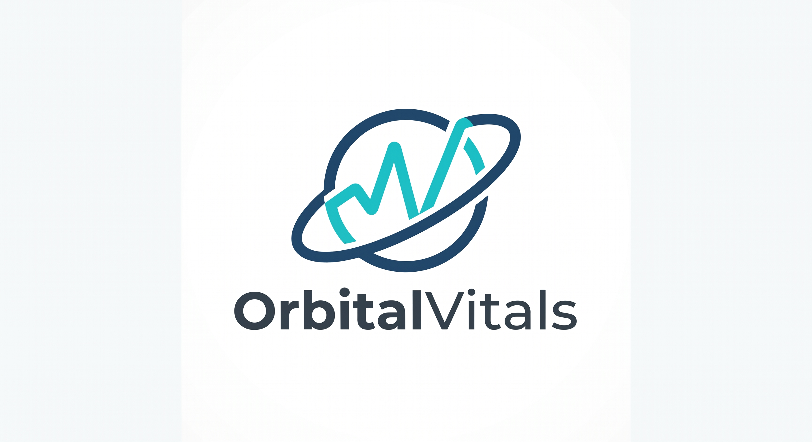

# 🚀 OrbitalVitals — Autonomous Deep Space Biomedical Monitor & Decision Support



> **"OrbitalVitals is the real-life 'Omnitrix' for astronauts: a tactical wearable and autonomous system that turns NASA Open Science data into a wrist-worn doctor capable of saving lives when Earth is 20 minutes of silence away."**
>
> *(PT-BR: "O **OrbitalVitals** é o 'Omnitrix da vida real' para astronautas: um bracelete e sistema autônomo que transforma dados científicos da NASA em um médico de pulso capaz de salvar vidas quando a Terra está a 20 minutos de silêncio.")*

---

## 🎥 Official Project Demo Video & Pitch Deck (NASA Space Apps Standard)

[](https://www.youtube.com/watch?v=Az7vgIXbIu8)

- **▶️ Official YouTube Demo Video (22s):** [https://www.youtube.com/watch?v=Az7vgIXbIu8](https://www.youtube.com/watch?v=Az7vgIXbIu8) *(short link: [https://youtu.be/Az7vgIXbIu8](https://youtu.be/Az7vgIXbIu8))*
- **🎬 GitHub Mirror Video (`1115.mp4`):** [https://github.com/marcos-robot-81/hackathon-nasa-2026/blob/main/1115.mp4](https://github.com/marcos-robot-81/hackathon-nasa-2026/blob/main/1115.mp4)
- **📊 Official Slide Deck (`OrbitalVitals cinematic scientific pitch.pdf`):** [OrbitalVitals cinematic scientific pitch.pdf](OrbitalVitals%20cinematic%20scientific%20pitch.pdf)
- **💻 Public Project Repository Link:** [https://github.com/marcos-robot-81/hackathon-nasa-2026](https://github.com/marcos-robot-81/hackathon-nasa-2026)
- **Duration:** `00:22` (`22.4s` — strictly compliant with the **≤ 30 seconds** NASA Space Apps Global Award rule, with English on-screen text and English subtitles).

---

## 🌌 1. Overview & Problem Statement

During deep-space missions (Moon, Mars transit, and planetary EVAs), radio communication delays with Earth reach up to **20 minutes each way (40 minutes round-trip)** or suffer complete blackouts. Astronauts often operate without an onboard Flight Surgeon and cannot interpret raw laboratory tables inside a pressurized spacesuit during an emergency.

**OrbitalVitals** is an **autonomous, 100% offline-first biomedical monitoring and clinical decision-support system** engineered for spacecraft avionics and tactical wrist wearables:

1. **Space-Grade Footprint (`< 24 MB RAM`):** Runs in pure **Java 25** (compatible with **JDK 21+**, `-Xms8m -Xmx24m`) using *Virtual Threads*, *Records*, and lock-free *Ring Buffers* with **zero external dependencies**.
2. **Embedded Statistical Anomaly Detection:** Computes real-time **EWMA** (*Exponentially Weighted Moving Average*) + **Z-Score** deviation relative to each astronaut's personal pre-flight baseline ($\mu_0, \sigma_0$).
3. **4 Physiological Systems Monitored:** Cardiovascular, Musculoskeletal, Neuro-Ocular (**SANS**), and Immune/Radiation.
4. **Traffic-Light Triage & Actionable Countermeasures:** Translates complex telemetry into `NOMINAL` (Green), `CAUTION` (Yellow), and `CRITICAL` (Red) states, explaining **why** the alert triggered (citing the exact **NASA OSDR** study) and **what to do right now**.
5. **Store-and-Forward Earth Outbox:** Locally queues clinical alert packets during communication blackouts and automatically synchronizes with Mission Control once radio link is restored.
6. **Multilingual Out-of-the-Box:** Instant real-time switching between **English (`EN`)**, **Portuguese (`PT`)**, and **Spanish (`ES`)**.


---

## 🧬 2. Scientific Validation & Official NASA Data Sources (OSDR, ALSDA, EDA & RadLab)

Instead of using black-box AI models that can hallucinate diagnoses in life-critical scenarios, **OrbitalVitals** calibrates its deterministic biophysical and statistical engine using official datasets, APIs, and `*_TRANSFORMED.csv` assay tables from the **NASA Open Science Data Repository (OSDR)**, **Ames Life Sciences Data Archive (ALSDA)**, **NASA GeneLab**, and **NASA RadLab**.

### 2.1. Classification by Operational Tier

#### 🔹 Tier 1 — Maximum Priority (Core System: Live Dosimetry & Human Orbital Hematology)
- **[NASA RadLab Data API](https://visualization.osdr.nasa.gov/radlab/api) (`GET /radlab/api`):**
  - **Metrics:** Absorbed radiation dose rate (`mGy/day`), Galactic Cosmic Rays (`GCR`), South Atlantic Anomaly (`SAA`), Solar Particle Events (`SPE`), and spacecraft/suit shielding attenuation (DosTel, TEPC, Liulin, RAD instruments).
- **[NASA Environmental Data Application (EDA)](https://visualization.osdr.nasa.gov/eda/):**
  - **Metrics:** Spacecraft cabin Temperature (`°C`), Relative Humidity (`%`), and `CO2` telemetry across ISS missions (`RR-1` through `RR-28`, `APEX`, `VEG-01C`).
- **[NASA OSDR OSD-569 (GLDS-561 / LSDS-7)](https://osdr.nasa.gov/bio/repo/data/studies/OSD-569) — *SpaceX Inspiration4* Human Mission (*Homo sapiens*):**
  - **Official Assay File:** `LSDS-7_Complete_Blood_Count_CBC_TRANSFORMED.csv`
  - **Clinical Application:** Longitudinal human pre-flight, in-flight, and post-flight Complete Blood Count (`CBC`), driving our **Neutrophil-to-Lymphocyte Ratio (`NLR`)** immune dysfunction and radiation-stress biomarker.
- **[NASA OSDR OSD-575 (LSDS-8)](https://osdr.nasa.gov/bio/repo/data/studies/OSD-575) — *SpaceX Inspiration4* Human Mission (*Homo sapiens*):**
  - **Official Assay Files:** `LSDS-8_Multiplex_serum_cardiovascular_EvePanel_TRANSFORMED.csv`, Comprehensive Metabolic Panel (`CMP`), `HDCVD9` cardiovascular panel, and `HD71`/`NULISA-seq` cytokines.
  - **Clinical Application:** Calibrates **C-Reactive Protein (`CRP mg/L`)** acute systemic inflammation and cardiovascular biomarker drift.
- **Additional *SpaceX Inspiration4* Human Studies Consulted:** [OSD-570](https://osdr.nasa.gov/bio/repo/data/studies/OSD-570), [OSD-571](https://osdr.nasa.gov/bio/repo/data/studies/OSD-571), [OSD-572](https://osdr.nasa.gov/bio/repo/data/studies/OSD-572), [OSD-573](https://osdr.nasa.gov/bio/repo/data/studies/OSD-573), [OSD-574](https://osdr.nasa.gov/bio/repo/data/studies/OSD-574), [OSD-630](https://osdr.nasa.gov/bio/repo/data/studies/OSD-630), [OSD-656](https://osdr.nasa.gov/bio/repo/data/studies/OSD-656), and [OSD-687](https://osdr.nasa.gov/bio/repo/data/studies/OSD-687).

#### 🔹 Tier 2 — High Priority for Long-Duration Modeling (SANS, Bone DEXA & Human Bed-Rest Analogs)
- **[NASA OSDR OSD-435 (LSDS-22)](https://osdr.nasa.gov/bio/repo/data/studies/OSD-435) & [OSD-591 (LSDS-23)](https://osdr.nasa.gov/bio/repo/data/studies/OSD-591) — Cardiovascular & Aortic Hemodynamics:**
  - **Official Assay File:** `LSDS-22_Echocardiography_aorta_TRANSFORMED.csv`
  - **Clinical Application:** Models **Aortic Peak Blood Velocity (`cm/s`)** and radiation-induced vascular stiffness over 3–9 month mission horizons.
- **[NASA OSDR OSD-815](https://osdr.nasa.gov/bio/repo/data/studies/OSD-815), [OSD-816](https://osdr.nasa.gov/bio/repo/data/studies/OSD-816), [OSD-817](https://osdr.nasa.gov/bio/repo/data/studies/OSD-817), [OSD-818](https://osdr.nasa.gov/bio/repo/data/studies/OSD-818) (`LSDS-136`, `LSDS-135`, `LSDS-132`) — Human *Ex-Vivo* SANS Models:**
  - **Clinical Application:** Translaminar pressure gradient (`ICP:IOP`), electroretinography, optic disc edema (`mm`), and **Optic Nerve Tilt (`°`)** for **Spaceflight-Associated Neuro-Ocular Syndrome (SANS)**.
- **[NASA OSDR OSD-942](https://osdr.nasa.gov/bio/repo/data/studies/OSD-942), [OSD-195](https://osdr.nasa.gov/bio/repo/data/studies/OSD-195), [OSD-198](https://osdr.nasa.gov/bio/repo/data/studies/OSD-198), [OSD-783](https://osdr.nasa.gov/bio/repo/data/studies/OSD-783) — Human Ground Analogs (*Homo sapiens*):**
  - **Clinical Application:** 21-to-64-day human head-down tilt bed-rest and 7-day dry immersion analogs for chronic deconditioning.
- **[NASA OSDR OSD-108](https://osdr.nasa.gov/bio/repo/data/studies/OSD-108), [OSD-310 (LSDS-30)](https://osdr.nasa.gov/bio/repo/data/studies/OSD-310), [OSD-417](https://osdr.nasa.gov/bio/repo/data/studies/OSD-417), [OSD-471](https://osdr.nasa.gov/bio/repo/data/studies/OSD-471), [OSD-661](https://osdr.nasa.gov/bio/repo/data/studies/OSD-661)–[OSD-664](https://osdr.nasa.gov/bio/repo/data/studies/OSD-664), [OSD-977](https://osdr.nasa.gov/bio/repo/data/studies/OSD-977) — Bone Mineral Density & Spine Strength:**
  - **Clinical Application:** Dual-energy X-ray absorptiometry (`DEXA/DXA`), trabecular histomorphometry (`OSD-310`), and **Vertebral Flexural Fracture Strength (`OSD-471`)**.

#### 🔹 Tier 3 — Molecular Context & Behavioral Monitoring
- **[NASA OSDR OSD-1005](https://osdr.nasa.gov/bio/repo/data/studies/OSD-1005) (PROMETEO 2):** Neuronal antioxidant protection against spaceflight oxidative stress.
- **[NASA OSDR OSD-952](https://osdr.nasa.gov/bio/repo/data/studies/OSD-952):** Automated in-flight behavioral and circadian sleep segmentation.

---

### 2.2. Summary Matrix: 4 Body Systems vs. NASA OSDR Sources

| Physiological System | Monitored Metrics in OrbitalVitals | Official NASA OSDR Datasets & Endpoints |
| :--- | :--- | :--- |
| **1. Cardiovascular** (`CARDIOVASCULAR`) | Heart Rate (`BPM`), `HRV (RMSSD ms)`, Systolic/Diastolic BP, `SpO2 (%)`, **Aortic Peak Velocity (`cm/s`)** | `OSD-435 (LSDS-22)` Echocardiography & `OSD-575 (LSDS-8)` *Inspiration4* Cardiovascular Panel |
| **2. Musculoskeletal** (`MUSCULOSKELETAL`) | Monthly Bone Loss Rate (`%/mo`), Cumulative **DEXA Bone Loss (`%`)**, **Vertebral Strength (`%`)** | `OSD-108`, `OSD-310 (LSDS-30)`, `OSD-471` (Vertebral Biomechanics) & `OSD-942` (64d Human Bed-Rest) |
| **3. Neuro-Ocular / SANS** (`NEURO_OCULAR`) | Intraocular Pressure (`IOP mmHg`), Optic Disc Edema (`mm`), **Optic Nerve Tilt (`°`)** | `OSD-815`, `OSD-816`, `OSD-817`, `OSD-818 (LSDS-136)` Human *Ex-Vivo* SANS Translaminar Models |
| **4. Immune & Radiation** (`IMMUNE_RADIATION`) | External vs. Shielded Dose (`mGy/d`), Cumulative Dose (`mGy`), **NLR Ratio**, **CRP (`mg/L`)** | `NASA RadLab API`, `OSD-569 (LSDS-7)` *Inspiration4* CBC & `OSD-575 (LSDS-8)` Cytokines/CRP |

---

### 2.3. Biophysical & Statistical Equations Implemented in Java

All equations below are implemented in [`src/engine/TelemetrySimulator.java`](src/engine/TelemetrySimulator.java) and [`src/engine/AnomalyEngine.java`](src/engine/AnomalyEngine.java):

#### A. Gravitational Unloading Factor ($U_G$)
$$U_G = \max(0, \; 1.0 - G)$$
*(Where $G = 0.00\text{G}$ in deep space, $0.16\text{G}$ on the Moon, $0.38\text{G}$ on Mars, and $1.00\text{G}$ on Earth).*

#### B. Bone Mineral Density (DEXA) & Vertebral Strength (`OSD-108`, `OSD-471`, `OSD-942`)
- **Monthly Bone Loss Rate (`%/month`):**
  $$\text{Rate}_{\text{month}} = 0.08 + (1.27 \times U_G)$$
- **Cumulative Bone Mineral Density Loss after $D$ Mission Days (`%`):**
  $$\text{CumulativeBoneLoss}(D, G) = \text{Rate}_{\text{month}} \times \left(\frac{D}{30.0}\right)$$
- **Estimated Vertebral Mechanical Strength (`%`, calibrated from `OSD-471` where trabecular strength degrades at $\sim 1.65\times$ areal BMD loss):**
  $$\text{VertebralStrength}(D, G) = \max\left(65.0, \; 100.0 - 1.65 \times \text{CumulativeBoneLoss}(D, G)\right)$$

#### C. Neuro-Ocular Syndrome / SANS (`OSD-815..818` / `LSDS-136`)
- **Intraocular Pressure (`IOP mmHg`):**
  $$\text{IOP}(D, G) = 14.2 + (4.2 \times U_G) + \left(3.8 \times U_G \times \min\left(1.0, \frac{D}{45.0}\right)\right)$$
- **Optic Nerve Tilt (`°`):**
  $$\text{OpticTilt}(D, G) = 1.2^\circ + \left(6.8^\circ \times U_G \times \min\left(1.0, \frac{D}{60.0}\right)\right)$$

#### D. Radiation Shielding (`NASA RadLab`) & Immune Inflammation (`OSD-569` / `OSD-575`)
- **Shielding Attenuation:** Spacecraft hull blocks **78%** of external radiation ($\text{Transmission} = 0.22$), whereas an EVA Spacesuit blocks **32%** ($\text{Transmission} = 0.68$).
- **Neutrophil-to-Lymphocyte Ratio (`NLR`, `OSD-569` / `LSDS-7`) & C-Reactive Protein (`CRP mg/L`, `OSD-575` / `LSDS-8`):** Rise dynamically with absorbed internal tissue dose (`mGy/day`) and Solar Particle Events (`SPE`).

#### E. Embedded EWMA + Z-Score Anomaly Triage
For every incoming telemetry sample $x_t$ with personal pre-flight baseline $(\mu_0, \sigma_0)$:
$$\text{EWMA}_t = \alpha x_t + (1 - \alpha)\text{EWMA}_{t-1}, \qquad Z_t = \frac{|\text{EWMA}_t - \mu_0|}{\sigma_0}$$
- 🟢 **`NOMINAL`:** $Z_t < 1.8$
- 🟡 **`CAUTION`:** $1.8 \le Z_t < 2.8$
- 🔴 **`CRITICAL`:** $Z_t \ge 2.8$ (triggers immediate survival countermeasure protocol + queues packet in the **Earth Sync Outbox**).

---

### 2.4. Official NASA Open Science APIs & Programmatic Endpoints Used

- **NASA OSDR Biological Data API v2 (REST):** `https://visualization.osdr.nasa.gov/biodata/api/v2/datasets/`
- **NASA OSDR Query API v2:** `https://visualization.osdr.nasa.gov/biodata/api/v2/query/data/`
- **NASA RadLab Data API:** `https://visualization.osdr.nasa.gov/radlab/api`
- **NASA Environmental Data Application (EDA):** `https://visualization.osdr.nasa.gov/eda/`
- **NASA OSDR Public Amazon S3 Bucket:** `s3://nasa-osdr/` (`us-west-2`, open access `*_TRANSFORMED.csv` files)
- **SPOKE-GeneLab Knowledge Graph MCP Server:** `https://visualization.osdr.nasa.gov/kg/mcp`

---

## ⚡ 3. Quick Start (Run in 5 Seconds)

### Prerequisites
- **JDK 25** (compatible with **JDK 21+** — uses standard library Virtual Threads and Records with zero external dependencies).

### Linux / macOS / Git Bash
```bash
./run.sh
```

### Windows (PowerShell)
```powershell
mkdir -Force build
javac -encoding UTF-8 -d build (Get-ChildItem -Recurse src -Filter *.java | ForEach-Object { $_.FullName })
java -Xms8m -Xmx24m -XX:+UseSerialGC -XX:TieredStopAtLevel=1 -cp build main
```

Then open the interactive tactical dashboard in your browser:
👉 **`http://localhost:8080`**

*(Optional CLI single-run diagnostic mode: `java -cp build main en --once`, `pt --once`, or `es --once`).*

---

## 📂 4. Project Structure

```text
hackathon-nasa-2026/
├── README.md                                     # Project documentation & NASA OSDR scientific validation
├── 1115.mp4                                      # Official 22s Video Demo (<= 30s NASA Space Apps standard)
├── OrbitalVitals cinematic scientific pitch.pdf  # Official slide presentation deck
├── logo-OrbitalVitals.jpg                        # Official project logo
├── run.sh                                        # Ultra-low-RAM build & launch script (-Xms8m -Xmx24m)
├── img/
│   └── Monitor de Saúde Espacial...png           # Tactical wrist gauntlet concept render
└── src/
    ├── main.java                                 # Entry point (CLI + embedded server & simulator)
    ├── api/OrbitalServer.java                    # Native Java Virtual-Thread HTTP Server (/api/telemetry, /api/control)
    ├── db/LocalStore.java                        # Lock-free Ring Buffers, NASA OSDR catalog & Earth Sync Outbox
    ├── db/OsdrStudyRef.java                      # Record modeling official NASA OSDR dataset metadata
    ├── engine/AnomalyEngine.java                 # EWMA + Z-Score statistical triage & clinical rules
    ├── engine/TelemetrySimulator.java            # Biophysical simulator (Gravity, Days, EVA Suit, Solar Storm)
    ├── engine/SensorSnapshot.java                # Immutable snapshot of all 4 physiological systems
    ├── i18n/I18n.java                            # Multilingual dictionary (English, Portuguese, Spanish)
    ├── user/AstronautProfile.java                # Personal pre-flight baselines (μ0, σ0)
    └── web/index.html                            # Interactive 3D/SVG Body Map & Tactical Mission HUD
```

---

## 🛠️ 5. Tools, Open-Source Resources & Super Intelligence (SI) Disclosure

In compliance with the **NASA Space Apps Challenge** rules, we transparently disclose all software tools, open-source platforms, and Super Intelligence (SI) / AI tools used to accelerate development:

- **Programming Language & Runtime:** [OpenJDK (Java 21 / Java 25 Standard Library)](https://openjdk.org/) & [Open Web Standards (HTML5, CSS3, SVG, Vanilla JS)](https://developer.mozilla.org/)
- **Video Editing & Subtitles:** [CapCut](https://www.capcut.com/pt-br/)
- **Presentation Design & Graphics:** [Canva](https://www.canva.com/) & [GIMP (GNU Image Manipulation Program)](https://www.gimp.org/)
- **Super Intelligence (SI) / AI Tools Used:** [OpenAI ChatGPT](https://chatgpt.com/) and [Google Gemini](https://gemini.google.com/) (including Antigravity AI coding assistant) were used for NASA OSDR literature mapping, code/UI refactoring, multilingual translation (`EN`/`PT`/`ES`), and original concept illustration (zero NASA logos or restricted agency branding were generated or modified). The runtime biomedical engine itself executes 100% deterministic mathematical equations (`EWMA + Z-Score`) without generative AI in the clinical decision loop.
